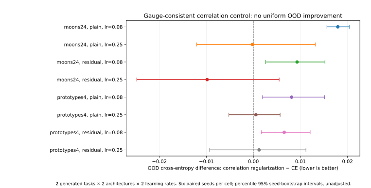

# OOD and architecture stress test of diagonal-gauge-consistent training (2026-11-08)

**Status:** completed controlled *synthetic* experiment. Supports the structural invariance mechanism in two upstream architectures and two generated distributions. **Does not** establish general OOD improvement or neural-network convergence.

## Executive finding / 結論

Prediction function and feature-channel correlations were invariant under a positive diagonal rescaling of the **final ReLU feature layer**, with the inverse rescaling of the downstream linear classifier. Coordinate-corrected SGD reconstructed the reference output path in both plain and upstream-GELU-residual MLPs. This held not just on in-distribution examples but also on independently generated distribution-shifted examples. The negative control, a normalized-covariance penalty, did **not** preserve the path. Unlike mechanistic invariance, OOD generalization **did not** systematically improve with correlation regularization (2 of 8 task/architecture/LR cells showed lower mean OOD cross entropy; 6 were higher).

This is a reproducible mechanism/negative-result report, **not a claim to have invented correlation regularization, gauge symmetry, preconditioning or a new convergence theorem**.

## 1. Design and measured results

- Tasks: `moons24` (2 moon coordinates, 22 independent nuisance features) and `prototypes4` (four labeled latent prototypes mixed into 18 observed coordinates plus 6 nuisance dimensions).
- Architectures: `plain` MLP 24→48(ReLU)→24(ReLU)→C and `residual` 24→48(ReLU)→residual branch with GELU→24(ReLU)→C.
- Training / validation / independent ID / independently generated OOD: 640 / 320 / 1200 / 1200 per task. Only the training split determines the feature standardization. For OOD, informative noise is increased and nuisance location/scale shifted; moons additionally rotate its two causal coordinates while preserving generated labels. This is a specified synthetic distribution shift, not real-world deployment drift.
- 6 seeds (8200–8205), 2 learning rates (0.08 and 0.25), 3 objectives (CE, CE+correlation penalty, CE+normalized-covariance penalty), 3 variants (identity SGD, heterogeneous scaling SGD, heterogeneous scaling compensated SGD): **432 train/holdout runs**, with 8 warmup + 90 measured updates. No model selection or hyperparameter retuning from holdout.
- PyTorch 2.10.0+cpu, CPU FP64, one thread, full-batch 640, momentum=0, weight decay=0; CPU clock not fixed. All measured quantities are dimensionless. `results/environment.json` records versions and runtime, which is not a throughput benchmark.

### Function-space path comparison

| Condition | Matched paths | Largest probe-logit deviation | ID/OOD holdout-logit deviation |
|---|---:|---:|---:|
| CE + corrected SGD | 48 | 0 (FP64 record) | 0 / 0 |
| Correlation penalty + corrected SGD | 48 | 0 (FP64 record) | 0 / 0 |
| Normalized covariance penalty + corrected SGD | 48 | 6.3173 | max 7.8117 / 9.3466 |

All 432 updates completed for 90 steps without nonfinite loss; the training, initial and holdout tables have 432 rows each. These are numerical results for power-of-two gauge scales, not a claim that floating-point arithmetic is mathematically exact.

### Held-out OOD cross-entropy: correlation vs CE (identity SGD)

Values are paired means over 6 seeds. Negative is better, positive is worse. CIs are seed-only 5,000-repeat percentile bootstrap intervals, not multiplicity-adjusted and not generalizable across source datasets.

| Task | Architecture | LR | OOD CE difference | 95% seed-bootstrap interval |
|---|---|---:|---:|---|
| moons24 | plain | 0.08 | +0.01795 | [+0.01563,+0.02037] |
| moons24 | plain | 0.25 | -0.00022 | [-0.01207,+0.01318] |
| moons24 | residual | 0.08 | +0.00928 | [+0.00259,+0.01521] |
| moons24 | residual | 0.25 | -0.00984 | [-0.02480,+0.00547] |
| prototypes4 | plain | 0.08 | +0.00811 | [+0.00192,+0.01512] |
| prototypes4 | plain | 0.25 | +0.00053 | [-0.00522,+0.00568] |
| prototypes4 | residual | 0.08 | +0.00655 | [+0.00168,+0.01207] |
| prototypes4 | residual | 0.25 | +0.00121 | [-0.00933,+0.01116] |

`results/paired_effects.csv` additionally includes ID differences, OOD balanced-accuracy differences, OOD reference CE, OOD correlation effective rank and off-diagonal correlation. Correlation effective rank **increased** in all eight matched cells and correlation penalty decreased, yet performance improved in only two cells. Thus improving this geometric diagnostic does not guarantee predictive improvement.

## 2. Mathematical mechanism and proof scope

### Variable table / 変数表

| Symbol | Meaning / 定義 | SI unit | Type, domain and assumptions |
|---|---|---|---|
| `x` | Input feature / 入力特徴 | 1 | vector in real 24-dimensional space |
| `a` | Upstream feature / 前段活性値 | 1 | vector in real 48-dimensional space; may result from residual/GELU backbone |
| `W`, `b` | Last feature layer / 最終特徴層の線形パラメータ | 1 | 24×48 real matrix, 24-vector |
| `h` | Feature after ReLU / ReLU後の特徴 | 1 | real 24-vector, elementwise nonnegative |
| `V`, `c` | Classifier weight, bias / 分類器の重み・バイアス | 1 | C×24 matrix, C-vector |
| `C` | Class count / クラス数 | 1 | positive integer, 2 or 4 here |
| `D` | Positive diagonal gauge / 正の対角変換 | 1 | invertible diagonal 24×24 with positive entries (repeats 0.25, 1, 4) |
| `Σ` | Centered feature covariance / 特徴共分散 | 1 | symmetric PSD 24×24 matrix |
| `R` | Feature correlation matrix / 相関行列 | 1 | symmetric 24×24 matrix; active channels have strictly positive variance |
| `η` | Learning rate / 学習率 | 1 | positive scalar, 0.08 or 0.25 |
| `λ` | Regularization coefficient / 正則化係数 | 1 | nonnegative scalar, fixed at 0.5 |
| `L_CE` | Classification cross entropy / 分類損失 | 1 | real nonnegative scalar |
| `L_corr`, `L_cov` | Correlation/covariance penalties / 正則化項 | 1 | real nonnegative scalars |
| `t` | Update index / 更新回数 | 1 | integer 0 through 90 |

Let the last feature layer and output logits be

\[
 h=\operatorname{ReLU}(Wa+b),\qquad f=Vh+c.
\]

For any positive diagonal matrix `D`, apply `W' = DW`, `b' = Db`, and `V' = VD^{-1}`. By coordinatewise positive homogeneity, `ReLU(Dz)=D ReLU(z)`; therefore `h'=Dh`, and

\[
 f'=V'Dh+c=VD^{-1}Dh+c=f.
\]

The equality holds **for every input** and does not depend on the distribution of `a`; this is why a nonlinear upstream residual architecture is allowed. From centered covariance, `Σ'=DΣD`, so ordinary covariance spectra/effective rank may change while predictions do not. Let `S=diag(Σ_{11}^{1/2},...,Σ_{dd}^{1/2})`, assuming all relevant variances are strictly positive and the active-channel mask is preserved. Since `S'=DS`,

\[
 R'=(S')^{-1}\Sigma'(S')^{-1}=(DS)^{-1}D\Sigma D(DS)^{-1}=S^{-1}\Sigma S^{-1}=R.
\]

Thus the mean of squared off-diagonal entries of `R` is invariant. By contrast, normalizing covariance by its mean diagonal is not generally invariant to *nonuniform* `D`.

For a gauge-invariant full objective `L`, the chain rule gives (at corresponding parameters)

\[
 \nabla_{W'}L'=D^{-1}\nabla_W L,\quad
 \nabla_{b'}L'=D^{-1}\nabla_b L,\quad
 \nabla_{V'}L'=(\nabla_VL)D.
\]

The compensated SGD update in transformed coordinates is

\[
 W'\leftarrow W'-\eta D^2\nabla_{W'}L',\quad
 b'\leftarrow b'-\eta D^2\nabla_{b'}L',\quad
 V'\leftarrow V'-\eta(\nabla_{V'}L')D^{-2}.
\]

Substituting the gradient rules shows `W'_{t+1}=DW_{t+1}`, `b'_{t+1}=Db_{t+1}`, and `V'_{t+1}=V_{t+1}D^{-1}`. The same relation holds at the initial step by construction; induction gives the same output function at all finite iterations. All terms, multipliers and losses are dimensionless, and every matrix multiplication is shape-consistent.

**Caveats:** There is a hard variance guard `EPS=1e-16`; exact correlation invariance can fail for a channel whose variance crosses that guard. The observed 432 runs had no borderline variance channels under the experiment's recorded guard. The proof applies to a fixed positive diagonal gauge on the final ReLU layer, plain full-batch SGD without momentum/weight decay, and unchanged upstream parameters. This is NOT an argument for unconstrained general linear transforms, arbitrary nonlinear features, AdamW, LayerNorm-transformer models, or asymptotic training convergence.

## 3. Falsifiable protocol and limitations — H/T/D/C/U

- **H:** The gauge-invariant correlation objective permits equivalent finite SGD paths under compensation across upstream architectures; under shift, correlation regularization improves OOD CE in all 8 matched setting cells.
- **T:** Frozen 432-run matched-factorial study, held-out ID/OOD 1,200 examples each; six seeds; eight predeclared OOD performance cells; no post-hoc tuning.
- **D:** Mechanistic prediction/correlation tolerances `<1e-9`, corrected path tolerance `<1e-7`: **PASS**. OOD CE improvement in every cell: **FAIL** (2/8 favorable only). No convergence claim.
- **C:** Optimization-side coordinate effects are sufficient to alter the learned result under ordinary SGD; reduced correlations may also erase task-useful dependencies. Stronger OOD shift/larger networks could behave differently.
- **U:** Six seeds on one fixed split per task; percentile bootstrap only across seeds (no across-distribution variance); model architecture, synthetic task specification, finite-sample covariance estimates, variance guard, CPU FP64, BLAS/ABI, and multiple testing. A complete combined standard uncertainty `u_c` and coverage factor `k` for transport across distributions are *not estimable from this design*; do not treat percentile CIs as such an uncertainty budget.

## 4. Reproduction and audit

Run from a clean directory with Python, the pinned requirements and enough CPU capacity to train 432 small full-batch models. The ID/OOD holdouts are not accessed during training. All source code and model-generation seeds are in this directory. See [REPRODUCE.md](REPRODUCE.md).

Core audit: `python -m pytest -q` and `python verify.py`. Models/large weight binaries are excluded from the public Git tree and can be regenerated; if omitted, `verify.py` reports checkpoint hash as UNVERIFIED rather than pretending they were checked.

The first attempt's end-of-run count assertion incorrectly specified 216 instead of 432 and raised after all 432 trainings. This arithmetic error was corrected *before* any test evaluation, recorded in the [original protocol](PROTOCOL.md), and a new full training was run without changing methods or hyperparameters. Weights and data were frozen before reading the holdout sets. All subsequent charts and claims use the rerun.

### Connections and non-novelty

- **Differential geometry:** coordinate choices and equivalent predictive functions.
- **Numerical optimization:** the Euclidean gradient is not covariant under parameterization; positive diagonal compensation functions as a restricted preconditioner.
- **High-dimensional statistics / representation learning:** covariance eigenvalues and correlation eigenvalues encode different coordinate properties; neither is automatically a causal measure of task usefulness.

Related prior art includes [Barlow Twins (Zbontar et al., 2021)](https://proceedings.mlr.press/v139/zbontar21a.html), [VICReg (Bardes et al., 2022)](https://arxiv.org/abs/2105.04906) and [Natural Gradient Works Efficiently in Learning (Amari, 1998)](https://doi.org/10.1162/089976698300017746). This study's regularizer is within a single representation, not the two-view cross-correlation objective of Barlow Twins.
